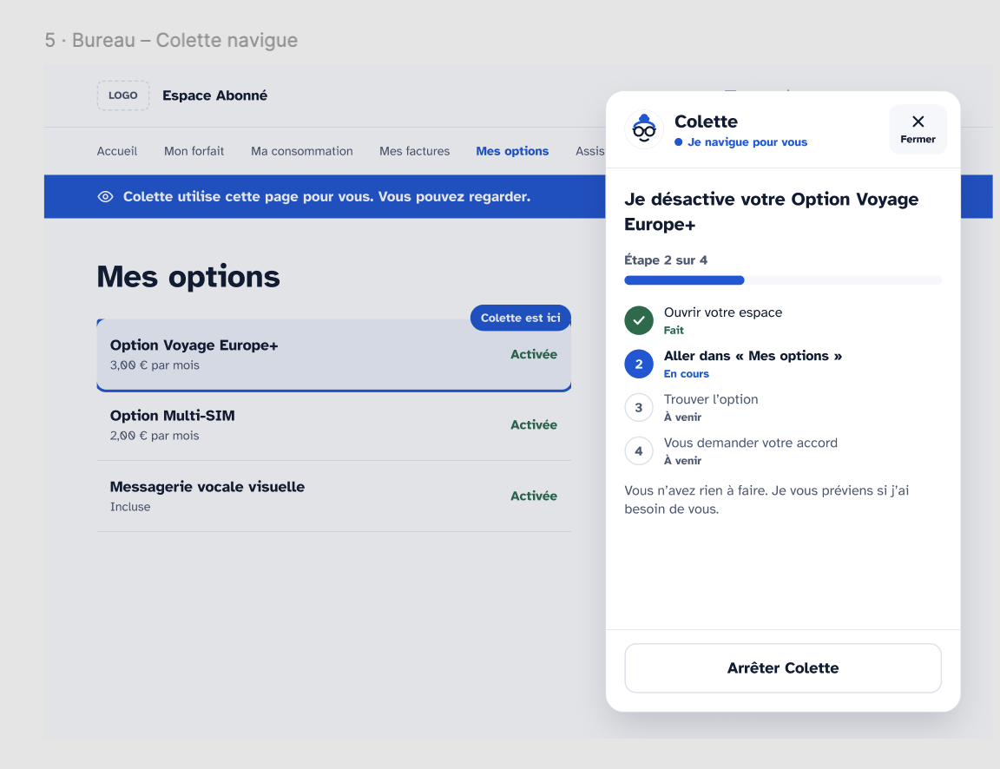
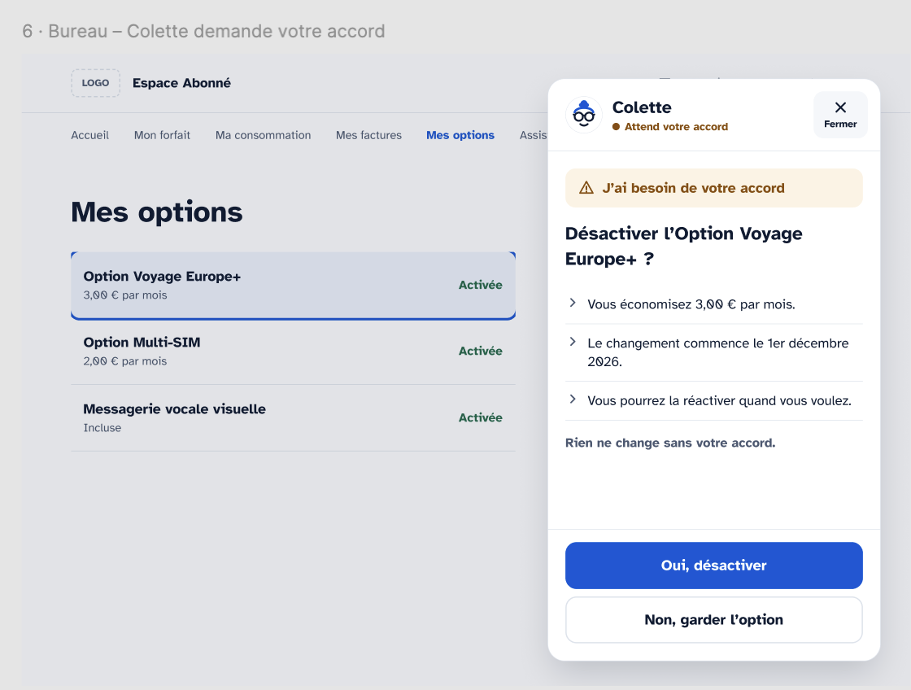
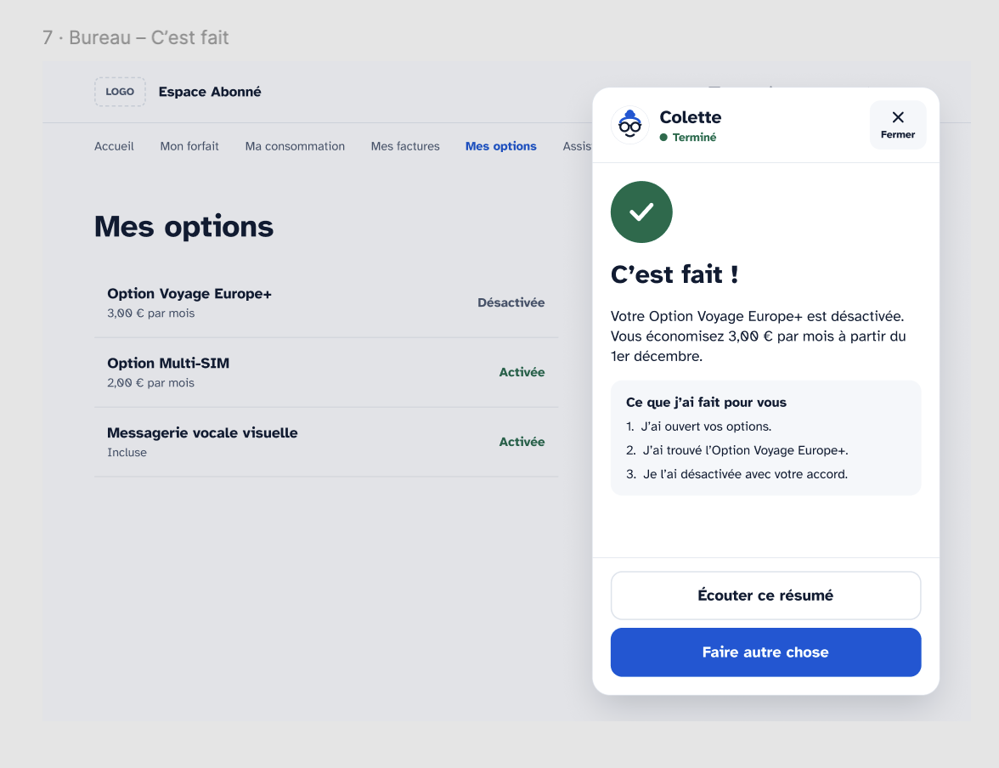

# Colette — a voice agent that does your online tasks for you

> Built in 30 hours at the **H Company × 42AI hackathon** (Paris, 7–8 Nov 2026).

Colette helps elderly and visually impaired people get things done on websites. They talk to her,
like on the phone, and she does the job in a real browser. She says each step out loud, asks for
anything she's missing, and **stops to get a spoken "yes" before anything that can't be undone**.

In France, **13 million people** struggle with digital tools, and about a third of the population
has already given up on a task because it had to be done online. Today they can ask a relative
(and hand over their password), queue at a public help desk, or give up. Colette is a fourth option.

<p align="center">
  
  
  
</p>

---

## 🧪 Test it live (2 minutes)

**👉 https://colette-chi.vercel.app/account/**

This is a **mock-up of a French mobile operator's customer area** (Free Mobile) with a fictitious
account. We built it so anyone can test safely: nothing is real, and you can reset it at any time.

1. Open the link in **Chrome or Edge on a laptop** (works best with headphones).
2. Log in with the demo account:
   | Customer ID | Password |
   |---|---|
   | `12345678` | `colette` |

   You type it yourself. Colette never sees or hears your password.
3. Click **"Need help? Call Colette"** (bottom right), then **allow the microphone**.
4. Say what you want, in English. For example:
   - *"I'd like to change my plan to a cheaper one."*
   - *"Can you show me my latest bill?"*
   - *"I'm travelling to China, does my plan work there?"*
   - *"How much data did I use this month?"*
   - *"I'd like an advisor to call me back."*
   - *"I want to change my email address."*
5. Watch: the bubble shows **what the agent's cloud browser sees**, live, plus the steps.
   Colette explains what she's doing and asks you questions out loud.
6. When she asks for approval (amber card), say **"yes"** or **"no"**, or click the buttons.
7. At the end, the page reloads with the change applied: your account really changed.

**You stay in control at all times**: say *"stop"* / *"wait"* or click **Stop Colette** and she
stops right away. Nothing irreversible happens without your explicit yes.

**Notes**
- **"Reset the demo"** (page footer) puts the account back to its starting state.
- The backend runs up to **6 sessions at once**. If Colette says she's busy, retry in a minute.
- Each task runs a real H Company computer-use agent in a cloud browser: allow **1–3 minutes** per task.
- Backend health: https://colette-production.up.railway.app/health

---

## How it works

```
 Person's browser (mock-up on Vercel + Colette bubble, widget.js)
        │  one WebSocket: mic audio ↑, voice ↓, bubble state, agent screenshots
        ▼
 Backend (FastAPI on Railway, colette/hosted.py)
   ├─ Voice pipeline (Pipecat):  Gladia STT → LLM (OpenRouter) → Cartesia TTS
   │     + hard guardrails for yes / no / stop, independent of the LLM
   └─ H Company Agents API: computer-use agent in a cloud browser
         opens the same account, clicks, fills forms, reads the page
         → each step is narrated, screenshots are streamed back to the bubble
```

1. **Understand.** Gladia transcribes speech in real time. The dialogue LLM turns it into a precise goal
   and picks a *skill* (`colette/skills_demo/*.md`: plan, bill, options, contact details, usage, travel, callback).
2. **Act.** The goal and the skill's instructions go to an **H Company computer-use agent**
   (`colette/h_agent.py`). It drives a real browser: no API on the website side, it works from the screen.
3. **Narrate.** Agent events become short spoken sentences (`colette/narration.py`) and a step-by-step progress bar.
4. **Ask.** When the agent needs info (a new address, which plan), it asks the person out loud and waits.
5. **Confirm.** Before any irreversible click (confirm plan change, save details, activate a paid option),
   the agent pauses. Colette reads the key facts (price, date, reversible or not) and waits for a clear spoken yes.
6. **Summarise.** Colette says what was done and shows a numbered recap.

### Safety by design
- **Passwords never go through the conversation or the agent.** The person logs in on their own page;
  the session is then shared with the agent's browser through a one-time link (`/colette/claim`).
- **Explicit approval** before irreversible actions; "yes / no / stop" are detected by deterministic rules,
  not left to the LLM alone.
- **Interruptible**: "stop" by voice or button cancels the H session immediately.
- **Scoped**: the agent is told to stay on the target site; it's stopped if it leaves.

---

## Tech stack & partners

| | Used for |
|---|---|
| **H Company Agents API** (`hai-agents`) | Computer-use agent that navigates the website (cloud browser online, local Chrome in dev) |
| **Gladia** | Real-time speech-to-text |
| **Pipecat** | Voice pipeline (STT → LLM → TTS, interruptions, VAD with Silero) |
| **Cartesia** | Text-to-speech (Colette's voice) |
| **OpenRouter** (Gemini 2.5 Flash) | Dialogue LLM: understands the request, picks the skill, phrases questions |
| **Vercel** | Hosts the mock-up website and the bubble |
| **Railway** | Hosts the voice + agent backend (Docker) |
| **Stripe** (business model, not in the demo) | Colette is B2B2C: operators and public services embed a "Call Colette" button and pay per completed task, billed with Stripe |

---

## Run it yourself

Requires **Python 3.12** and API keys for H Company, Gladia, OpenRouter and Cartesia.

```bash
git clone https://github.com/mene4485/colette.git
```

```bash
cd colette && python3.12 -m venv .venv && .venv/bin/pip install -r requirements.txt
```

```bash
cp .env.example .env   # then fill in HAI_API_KEY, GLADIA_API_KEY, OPENROUTER_API_KEY, CARTESIA_API_KEY, CARTESIA_VOICE_ID
```

### Option A — local demo (laptop mic + speakers, agent drives your local Chrome)

```bash
.venv/bin/python scripts/run_colette.py --demo-site
```

This starts the mock-up on http://localhost:8000, opens Chrome with the Colette bubble, and connects the
voice to the H agent. Log in with `12345678` / `colette`, then click the bubble.

- `--fake`: replays a recorded agent run (no H session used), handy to test the voice and UI.
- `--say "I'd like to change my plan"`: simulates the person without a microphone.

### Option B — hosted mode (same as the live link), on your machine

```bash
COLETTE_FAKE=1 scripts/run_hosted_local.sh
```

Then open http://localhost:8013/account/. Without `COLETTE_FAKE=1`, the real H agent runs in a cloud
browser, so the mock-up needs a public URL (set `COLETTE_SITE_URL`).

### Deploy
- Mock-up: `vercel deploy` (only `api/index.py`, `colette/demo_site.py` and `widget.js` are shipped,
  see `.vercelignore`). Set `COLETTE_BACKEND_URL`.
- Backend: the `Dockerfile` (Railway / Render). Set the API keys and `COLETTE_SITE_URL`.

---

## Repository map

| Path | What |
|---|---|
| `colette/hosted.py` | Online backend: WebSocket, voice pipeline, cloud H agent, shared demo accounts |
| `colette/voice.py` | Pipecat voice bot: Gladia, OpenRouter, Cartesia, yes/no/stop guardrails, tools |
| `colette/h_agent.py` | H Company agent runner: sessions, events, pause for approval, cancel |
| `colette/narration.py`, `colette/guide.py` | Agent events → spoken sentences and progress steps |
| `colette/skills_demo/` | One skill per task (instructions + steps + what needs approval) |
| `colette/demo_site.py` | The Free Mobile mock-up (standard library only) |
| `colette/static/widget.js` | The Colette bubble embedded in the page |
| `scripts/` | Entry points (`run_colette.py`, `run_hosted_local.sh`, `try_h.py`, …) |
| `docs/` | Design screens, system design, team context notes (in French) |

---

## Team

Menelik Nouvellon · Oleksander · Mialy · Nour

*The mock-up is not the Free website and is not affiliated with Free. All account data is fictitious.*
